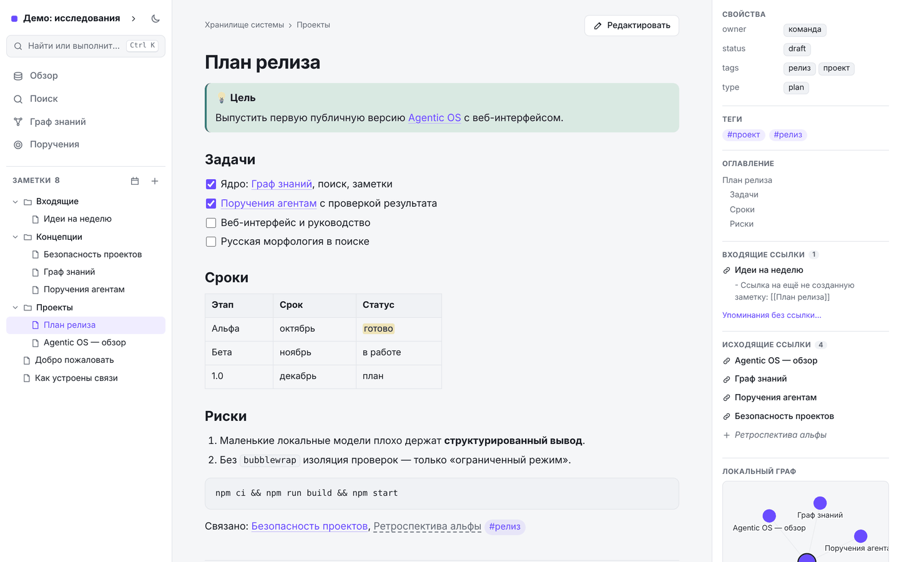
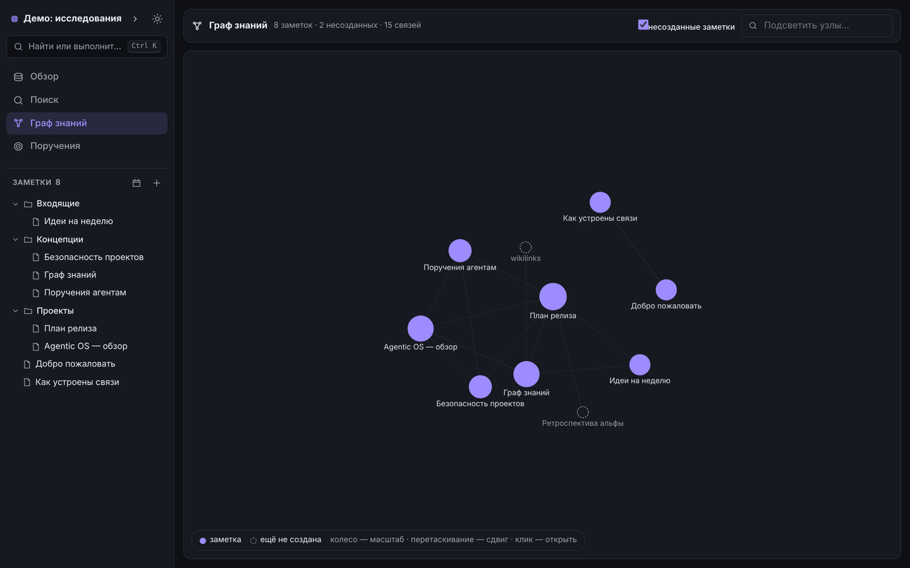
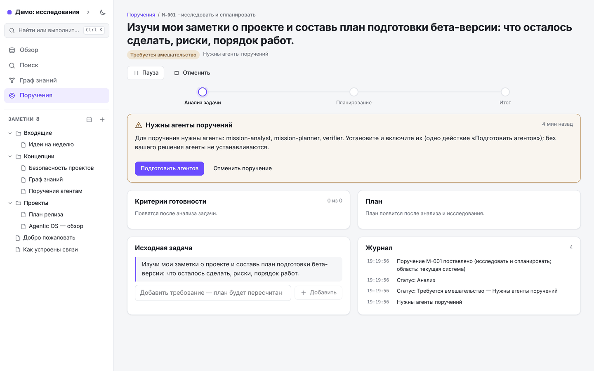

# Agentic OS

**Локальная система знаний, в которой AI-агенты работают с вашими заметками и проектами — и обязаны доказывать результат.**

[](https://github.com/sasha2011polyakov-dot/Agentic-Os/actions/workflows/ci.yml)
[](LICENSE)

[English version](README.md)

> **Статус: альфа.** Реализованы ядро, локальный HTTP API и первая версия веб-интерфейса.
> Десктоп-приложения **пока нет**: запустите локальный сервер и откройте интерфейс в браузере.



## Зачем

AI-ассистенты хорошо умеют выдавать текст, который *выглядит* как готовая работа. Agentic OS построена на обратном принципе:

- **Данные остаются у вас.** Заметки — обычные Markdown-файлы в ваших папках. Локальные модели (Ollama, LM Studio) работают без API-ключей; облачные модели необязательны и в локальном режиме не используются автоматически.
- **Агенты не могут незаметно менять ваши проекты.** Подключённые репозитории по умолчанию только читаются. Агенты лишь *предлагают* изменения; проверки идут в изолированной рабочей копии; до исходных файлов ничего не доходит без вашего просмотра, подтверждённых рисков и проверенной резервной копии.
- **«Готово» нужно заслужить.** Задача считается выполненной, только если критерии готовности подтверждены доказательствами: цитаты сверяются с источником программно, проверки должны реально запуститься и пройти, а «всё хорошо» от проверяющего агента без доказательства понижается.

## Что уже работает

| Область | Что реализовано |
|---|---|
| Системы знаний | Несколько независимых систем, каждая в своей папке со своей базой; добавление или переключение одной не затрагивает другие. |
| Заметки | Markdown-хранилище, `[[вики-ссылки]]`, свойства (frontmatter), шаблоны, история и восстановление, переименование с обновлением ссылок, вложения, ежедневные заметки. |
| Подключённые папки | Индексация проектов и репозиториев только на чтение (учитывает `.gitignore`, пропускает секреты), полнотекстовый поиск с операторами, граф знаний. |
| AI-ядро | Провайдеры: Ollama, OpenAI-совместимые серверы, Anthropic. Маршрутизация: локально / гибридно / облако, офлайн-режим, конфиденциальные источники — только локально, бюджеты, ключи хранятся по ссылке. |
| Агенты | Декларативные пакеты агентов (инструкции + JSON Schema входа и выхода + инструменты), разрешения выдаёт пользователь для каждой системы, 22 встроенных агента. |
| Процессы | Надёжный движок процессов (агенты, функции, подтверждения, циклы) с восстановлением после сбоя; встроенные конвейеры подготовки ТЗ и веб-исследования; трекер задач. |
| Веб-исследование | Безопасная загрузка страниц (защита от SSRF) и проверка цитат: утверждение засчитывается, только если цитата найдена в загруженной странице. |
| Поручения | Задача на естественном языке → анализ, исследование, выбор решения, план, выполнение, проверка, ограниченные циклы исправления, независимое ревью, честный итог. Пауза, продолжение, новые требования, запрет инструментов, повтор этапов. |
| Защита проектов | Режимы доступа (только чтение → подготовка → рабочая копия → применение), изолированные рабочие копии, проверенные резервные копии, согласование, привязанное к хешу содержимого, проверки в песочнице (bubblewrap, если есть), анализ скриптов, неизменяемый журнал безопасности с цепочкой хешей. |
| Расширения | Роли агентов, шаблоны, процессы, темы (CSS проходит фильтр) и плагины-инструменты. Плагины работают в ограниченном процессе Node и получают данные только через API, проверяющий выданные вами разрешения. |
| Локальный API | Слушает только `127.0.0.1`; ссылка входа с токеном, действующим до перезапуска, → cookie сессии; проверки Host/Origin/CSRF; строгий CSP. |
| Веб-интерфейс | Заметки с Markdown-редактором и подсказкой `[[ссылок]]`, свойства, входящие ссылки и упоминания без ссылки, дерево папок, полнотекстовый поиск с операторами, интерактивный граф знаний, поручения со всеми шагами подтверждения, палитра команд (`Ctrl/Cmd+K`), светлая и тёмная темы, вёрстка для телефона. |

## Быстрый старт

Нужно: **Node.js 22.13 или новее** (используется встроенный `node:sqlite`), npm, Git.

```bash
git clone https://github.com/sasha2011polyakov-dot/Agentic-Os.git
cd Agentic-Os
npm ci
npm test            # полный набор тестов (сеть и модель не нужны)
npm run build       # собирает веб-интерфейс и сервер
npm start           # печатает ссылку входа — откройте её в браузере
```

Ссылка содержит токен доступа, который действует до остановки сервера; не передавайте её другим.

Параметры: `npm start -- --port 4321 --data-dir ./my-data`. Папку данных можно задать и через `AOS_DATA_DIR`.

### Локальные модели

Установите [Ollama](https://ollama.com), загрузите модель, которая хорошо справляется со структурированным (JSON) выводом, и выберите её в настройках AI системы. Небольшие модели (меньше ~7B параметров) часто не справляются со структурированным выводом; если модель не справилась с этапом, движок пробует другую **локальную** модель и спрашивает вас, а не переключается на облако.

## Структура репозитория

```
packages/core            ядро: системы, хранилища, индексация, поиск, граф, AI, агенты,
                         процессы, поручения, защита проектов, расширения
packages/core/agents-builtin    встроенные пакеты агентов (только данные, без кода)
packages/core/plugin-runtime    защитный загрузчик и исполнитель плагинов (ограниченный процесс Node)
apps/server              локальный HTTP API и CLI
apps/ui                  веб-интерфейс (React); работает с сервером только через HTTP API
apps/desktop             в планах: десктоп-оболочка
docs/architecture        архитектурные документы (начните с overview.md)
docs/spec                исходные требования к крупным подсистемам
docs/research            исследования
```

## Скриншоты

| Граф знаний (тёмная тема) | Поручение ждёт вашего решения |
|---|---|
|  |  |

## Документация

- [Обзор архитектуры](docs/architecture/overview.md)
- [Модель безопасности и её ограничения](docs/architecture/security.md)
- [Поручения: задачи на естественном языке](docs/architecture/missions.md)
- [Движок процессов](docs/architecture/workflow-engine.md)
- [AI-ядро и веб-исследование](docs/architecture/ai-and-web-research.md)
- [Несколько систем знаний](docs/architecture/multi-system.md)

## Как помочь проекту

Нужны код, документация, переводы, роли агентов, темы, шаблоны и процессы. Роли агентов и темы — это обычные JSON, Markdown и CSS, поэтому помочь можно без знания TypeScript. Начните с [CONTRIBUTING.md](CONTRIBUTING.md) и задач с меткой `good first issue`.

## Безопасность

Не публикуйте уязвимости в открытых issue — см. [SECURITY.md](SECURITY.md). Абсолютно безопасного ПО не бывает; ограничения песочницы и изоляции расширений описаны в [docs/architecture/security.md](docs/architecture/security.md).

## Лицензия

[Apache License 2.0](LICENSE). См. также [NOTICE](NOTICE).

Проект разрабатывается с помощью [Claude Code](https://claude.com/claude-code).
